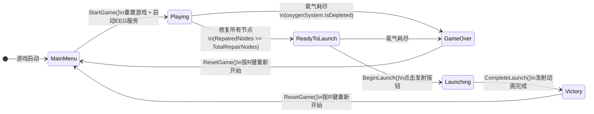
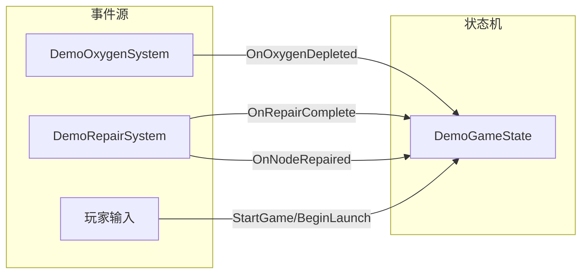

# 图4.1 游戏状态流转效果图

## 状态定义

| 状态 | 枚举值 | 说明 |
|------|--------|------|
| MainMenu | GameStatus.MainMenu | 主菜单界面，等待玩家开始游戏 |
| Playing | GameStatus.Playing | 游戏进行中，玩家可移动和修复节点 |
| ReadyToLaunch | GameStatus.ReadyToLaunch | 所有节点修复完成，火箭准备发射 |
| Launching | GameStatus.Launching | 火箭发射动画进行中 |
| Victory | GameStatus.Victory | 成功逃离月球，任务完成 |
| GameOver | GameStatus.GameOver | 氧气耗尽，任务失败 |

## 核心方法说明

| 方法 | 功能 | 调用时机 |
|------|------|----------|
| StartGame() | 重置游戏、启动EEG服务、进入Playing状态 | 玩家点击开始游戏 |
| ResetGame() | 重置氧气、修理节点、角色位置、火箭状态 | 返回主菜单 |
| RepairNode() | 修复单个节点，累计修复数量 | 玩家修复节点时 |
| ReadyForLaunch() | 进入ReadyToLaunch状态 | 所有节点修复完成 |
| BeginLaunch() | 进入Launching状态 | 玩家点击发射按钮 |
| CompleteLaunch() | 进入Victory状态 | 发射动画完成 |
| WinGame() | 进入Victory状态 | 快捷键V或发射完成 |
| GameOver() | 进入GameOver状态 | 氧气耗尽或快捷键G |

## 事件驱动机制

## 状态转换表

| 当前状态 | 触发条件 | 目标状态 | 代码位置 |
|----------|----------|----------|----------|
| MainMenu | StartGame() 调用 | Playing | Line 170-178 |
| Playing | 修复完成(IsFullyRepaired) | ReadyToLaunch | Line 108-111 |
| Playing | 氧气耗尽(IsDepleted) | GameOver | Line 99-103 |
| ReadyToLaunch | BeginLaunch() 调用 | Launching | Line 158-163 |
| ReadyToLaunch | 氧气耗尽 | GameOver | Line 117-120 |
| Launching | CompleteLaunch() 调用 | Victory | Line 165-168 |
| Victory | ResetGame() 调用 | MainMenu | Line 196-243 |
| GameOver | ResetGame() 调用 | MainMenu | Line 196-243 |
